# Plannr architecture

How Plannr's parts fit together. Section 1 explains the words; section 2
is the whole system at a glance; section 3 walks through every step of
sharing a link; the sections after that zoom in on one topic each. On
every diagram, **each arrow says what it does**.

**Numbering:** the five **groups** of the system are numbered **1-5**
(1 phone, 2 server, 3 database, 4 worker, 5 outside services), and the
parts inside a group are **1a, 2c** and so on. The steps of sharing a link
are **① to ⑰**, in order. **Yellow** marks an open design question.

## §1 · Words used on this page

| Word | What it means here |
|---|---|
| **AI client** | The part of the worker that sends text or a screenshot to Groq and reads back its answer. |
| **API** | The set of addresses the server answers on. The phone app uses it to send and fetch things over the internet. "The server" and "the API" are used to mean the same program. |
| **APK** | The installable app file for Android. |
| **Branch** | A separate line of changes in git, kept apart from `main` until it's merged. |
| **Capture** | **One thing you shared** (a link or a screenshot) and its progress towards becoming a card: *waiting*, *being processed*, *done* or *failed*. Each capture is a row in the captures table. |
| **Card** | **The result of a capture:** an activity with its title, date and time, place, price and description. You can edit it, keep it, or send it to a group. |
| **Chromium** | A real web browser with no window, used for pages that only show their content after running JavaScript. Playwright is the library that drives it. |
| **CI** | Automatic checks that GitHub runs on every change: build the code and run the tests. |
| **Completion checker** | The part of the server that looks for captures the worker has finished, so it can tell your phone. |
| **Data pool** | A saved set of real links, with the correct answers written down by hand, used to measure how accurate Plannr's reading is. |
| **Database** | Where everything is stored, in tables (MySQL). |
| **Dependency injection** | The program is told at start-up which real or fake version of each part to use, instead of each part creating its own. This is what lets tests swap in fakes. |
| **Development build** | Your own copy of the app, installed on your phone, that still loads its code live from the laptop while we work on it. |
| **Endpoint** | One address on the API that does one job, such as "accept a shared link". |
| **Error reference** | A short code shown with an error, such as `7f3a9c21:03:01`, that finds the matching line in the log. |
| **Eval** | A command-line tool on the laptop that runs the same extraction as the worker, for testing and measuring accuracy. |
| **Expo** | A toolkit for building phone apps with React Native: ready-made modules plus a build service (EAS). |
| **Expo push service** | Expo's servers, which deliver notifications to phones. |
| **Extraction pipeline** | The fixed sequence of steps that turns a capture into a card: fetch the content, read its hidden details, ask the AI for what's missing, check and tidy the answer, add flags. |
| **Fake** | A stand-in used in tests in place of something outside, for example an AI that returns prepared answers without using the internet. |
| **Flag** | A marker on one field of a card that Plannr isn't sure about (missing, uncertain or unreadable), highlighted for you to check. |
| **Groq** | The company whose servers run the AI (the LLM) Plannr uses. |
| **Group** | Friends who plan together in Plannr. |
| **Interface** | A description of what a part must be able to do, without saying how. Code that uses an interface works with any part that fits it, real or fake. |
| **Job loop** | The worker's main loop: take the next waiting capture, process it, repeat. |
| **JSON-LD** | Event details that many websites hide in their pages for search engines: name, date, venue, price, in a standard machine-readable form. |
| **Library** | Code that never runs on its own; it's built into programs that use it. |
| **LLM** | Large language model: an AI that reads text (or images) and answers questions about it. |
| **Live updates hub** | The part of the server that keeps a connection open to each running app, so it can tell the app about changes instantly (SignalR). |
| **main** | The main branch: the version of the code that counts. |
| **Open Graph tags** | A title, description and image hidden in a web page so link previews look right. |
| **Plan** | A card sent to a group to agree a date. |
| **Program** | Code that runs on its own: the phone app, the server, the worker, Eval, the database. |
| **Pull request** | A request on GitHub to merge a branch into `main`, where the changes can be checked and approved. |
| **Push notification** | A message that appears on your phone when the Plannr app isn't open. |
| **React Native** | A way to write a phone app in TypeScript that turns into real Android screens. |
| **Response** | A group member's yes or no to a plan. |
| **Retriever** | The part that fetches the content for one kind of link: web pages, TikTok, YouTube. |
| **Safety guard (SSRF)** | A check that stops a shared link from pointing the server at its own private network. |
| **Scraping** | Reading a web page's content automatically. |
| **Server** | A computer on the internet, and the program running on it, that the app talks to. Plannr's server program is `Plannr.Api`. |
| **Share sheet** | The list of apps your phone shows when you tap Share. |
| **Wishlist** | All your saved cards. |
| **Worker** | A second server program that does the slow work (fetching pages, asking the AI) in the background, so the server can always answer quickly. |

## §2 · The system at a glance

The five groups, and what passes between them. Section 3 opens each group
up into its parts and walks through every step.

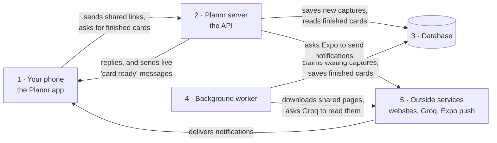

## §3 · Sharing a link, step by step

Every part of every group has its own column, under its group's heading.
The steps run **top to bottom, ① to ⑰**; each one starts where the one
before it ended. Solid arrows are requests, dashed arrows are the replies.

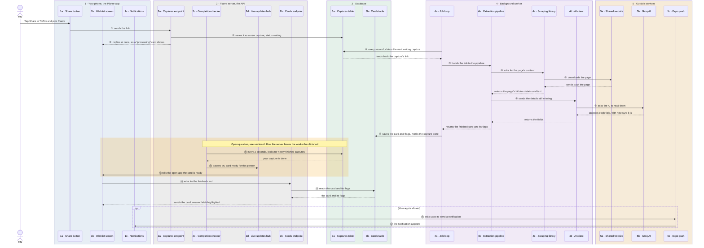

| Step | Arrow | What happens |
|---|---|---|
| ① | 1a → 2a | You tap Share in TikTok (or a browser, or your photos) and pick Plannr. The app sends the link to the server. |
| ② | 2a → 3a | The server checks it's a kind of link Plannr can read, then saves it as a new **capture** with the status *waiting*. |
| ③ | 2a → 1b | The server replies straight away, without waiting for the slow part, so your wishlist shows a "processing" card at once. |
| ④ | 4a → 3a | The worker checks every second for waiting captures and claims the oldest one, so no other worker takes it too. |
| ⑤ | 4a → 4b | The job loop hands the link to the extraction pipeline. |
| ⑥ | 4b → 4c | The pipeline asks the scraping library for the page's content. |
| ⑦ | 4c → 5a | The scraping library downloads the page, using the hidden browser only if the page needs JavaScript, and returns the page's hidden event details and text. |
| ⑧ | 4b → 4d | The pipeline reads the hidden event details itself, then sends whatever is still missing to the AI client. |
| ⑨ | 4d → 5b | The AI client asks Groq to read the content and gets back each field with how sure it is. The pipeline checks and tidies the answer and adds flags. |
| ⑩ | 4a → 3b | The finished card and its flags are saved, and the capture is marked *done* (or *failed*, with a message and an error reference). |
| ⑪ | 2c → 3a | The server's completion checker looks every 2 seconds for captures that have just finished. **This is the open question in section 4.** |
| ⑫ | 2c → 2d | It passes "card ready for this person" to the live updates hub. |
| ⑬ | 2d → 1b | The hub tells your app, if it's open, that the card is ready. |
| ⑭ | 1b → 2b | The app asks the server for the finished card. |
| ⑮ | 2b → 3b | The server reads the card and its flags and sends them back; the app shows the card with unsure fields highlighted. |
| ⑯ | 2c → 5c | If your app is closed, the server asks Expo's push service to send a notification instead. |
| ⑰ | 5c → 1c | The notification appears on your phone. |

If anything fails (the page won't load, Groq is down), step ⑩ marks the
capture *failed* with a message for you and an error reference, and steps
⑪-⑰ tell your phone in the same way.

## §4 · Open question: how the server finds out a card is ready

**The problem:** the card is finished **inside the worker** (group 4), but
your phone's live connection is to the **server** (group 2). They are two
separate programs, usually on separate machines, so something has to carry
"this capture is done" from one to the other. In section 3 this is step ⑪.

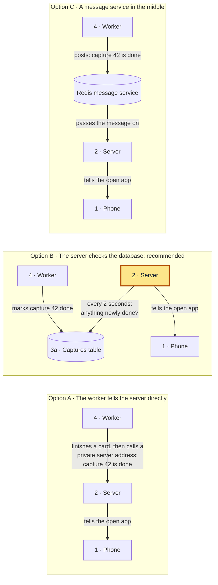

| | Option A: worker tells the server | **Option B: server checks the database** | Option C: message service |
|---|---|---|---|
| Delay | None | Up to 2 seconds (the card itself takes several seconds anyway) | None |
| Extra things to build | A private address on the server, plus a password so nobody else can call it | A small loop in the server | A Redis server to run and pay for |
| If the server restarts | The worker's call fails, so it needs retrying | Nothing is lost: it carries on where it left off | Messages can be lost unless stored |
| If two copies of the server run | Only the copy that got the call tells its phones | **Works:** each copy checks and tells its own phones | Works |

## §5 · Programs and libraries: where scraping lives

**The scraping library is a library, not a separate service, so nothing
talks to it through an API.** It's code built into the worker program.
The worker calls it like any other function, inside the same running
program. Separate programs, like the server and the worker, can't call each
other's functions; they meet only through the database.

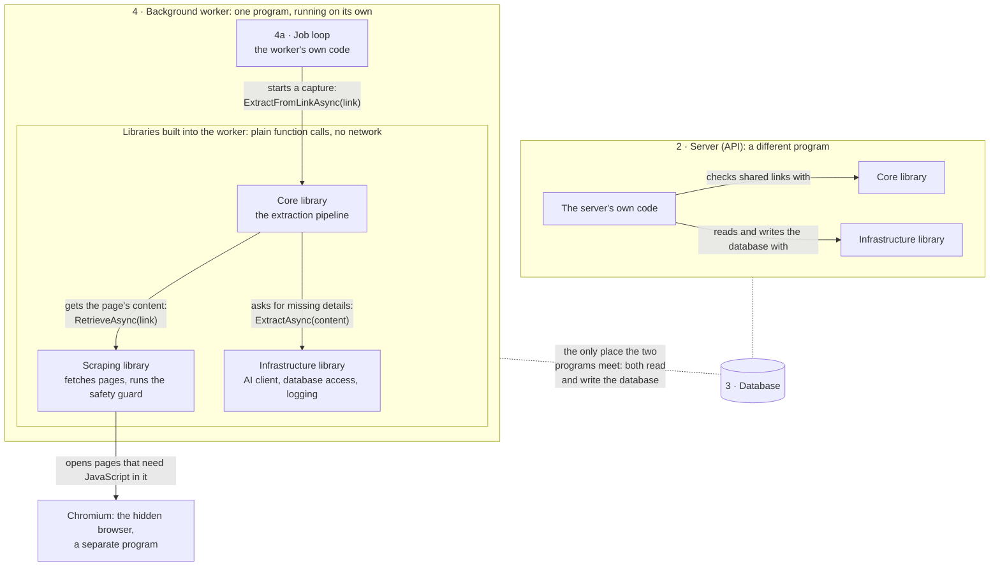

**Why scraping is its own library:** the browser code is large (about
130 MB with its driver) and the server never opens a web page. Kept in its
own library that **only the worker and Eval use**:
- the server stays small and quick to deploy, with less to keep up to date;
- the server **can't** run browser code even by mistake, because it doesn't contain it, so a crashed browser can never take the server down.

## §6 · Which part may use which

Arrows point at the code being used.

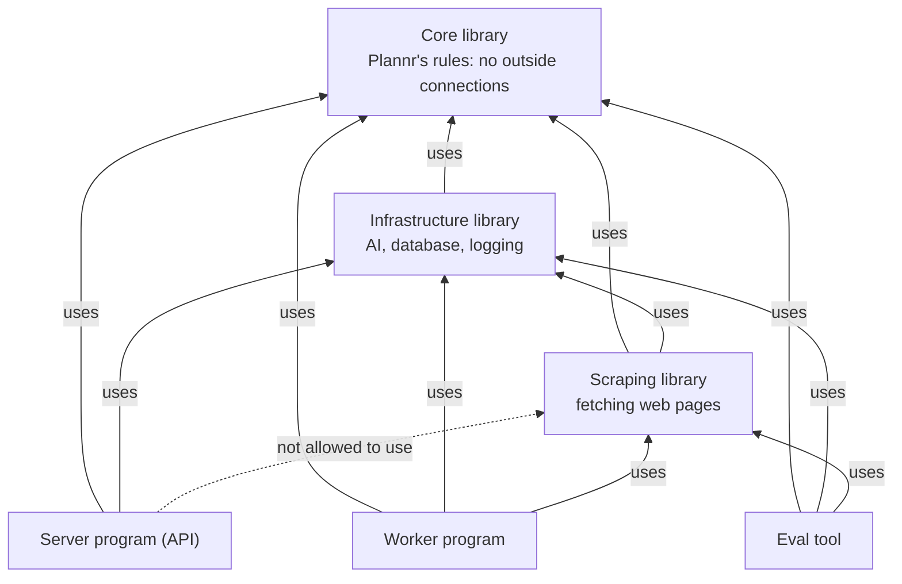

## §7 · Outside connections behind interfaces

**The rule:** everything that reaches outside the program sits behind an
interface. The real program is set up to use the real thing; tests are set
up to use a fake, through the same dependency injection. The code in the
middle only knows the interface, so it works with either.

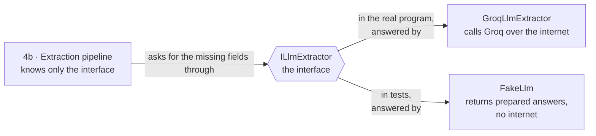

| Outside thing | Interface | Real version | Test version |
|---|---|---|---|
| Web pages | `IPageFetcher` | `HttpPageFetcher` | serves saved pages |
| The hidden browser | `IBrowserPageFetcher` | `PlaywrightPageFetcher` | returns prepared HTML |
| Groq | `IGroqApi`, `ILlmExtractor` | Groq over HTTPS | prepared answers |
| The clock | `TimeProvider` | the real clock | a clock the test moves |
| Address lookups (DNS) | `IHostResolver`, still to be added: the safety guard calls DNS directly | the real DNS | prepared addresses |
| The database | one interface per table | MySQL | in-memory tables |
| The list of waiting captures | `ICaptureQueue` | the captures table | an in-memory list |
| Telling the phone | `INotificationService` | live updates hub + Expo push | records what was sent |
| Expo push | `IExpoPushApi` | Expo over HTTPS | records what was sent |
| TikTok | `ITikTokOEmbedApi` | TikTok over HTTPS | prepared captions |
| YouTube | `IYouTubeDataApi` | YouTube over HTTPS | prepared descriptions |

## §8 · Getting the app onto your phone

**Three layers.** We write the app in TypeScript. **React Native** turns
our screens into real Android screens. **Expo** adds ready-made modules
(notifications, secure storage, share handling) and **EAS**, its free build
service, which makes the installable app file (the **APK**) so you don't
need Android Studio.

An Android app has two parts:
- a **native part**, fixed at the moment the app file is built. It includes the app's *manifest*, which tells Android what the app can do, such as "I accept shared links";
- a **JavaScript part**: our code, which can be swapped while developing.

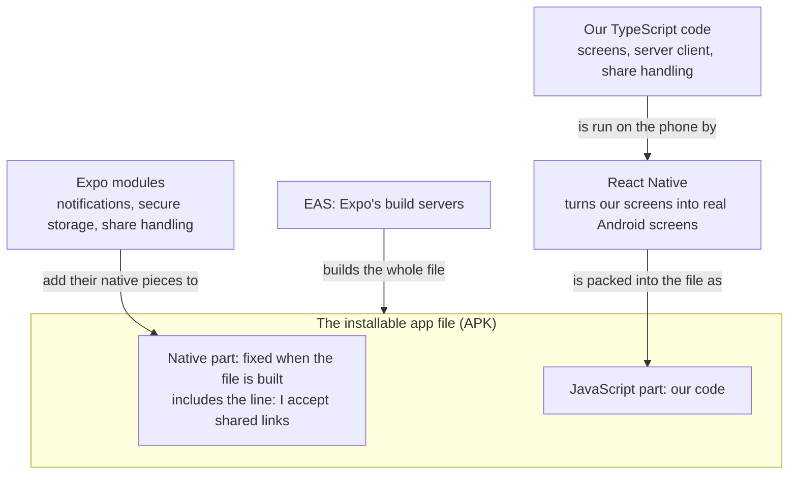

**Why the share sheet decides everything.** When you tap Share in TikTok,
Android looks through every installed app's manifest for "I accept shared
text" and lists those apps. Plannr only appears if **its own** manifest
says so.

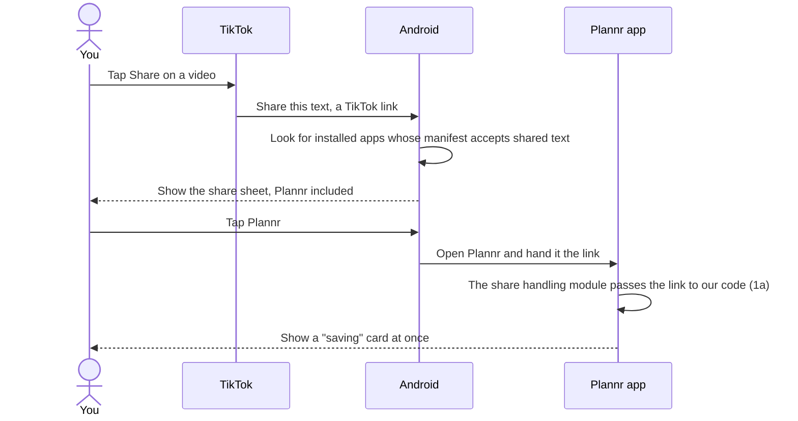

**Three ways to run the app:**

**How the development build reaches your phone:**

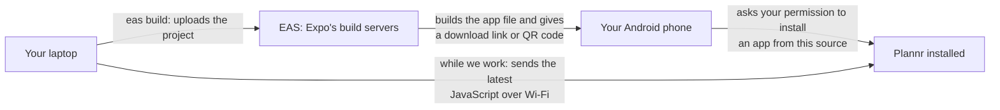

## §9 · Approving changes before they reach `main`

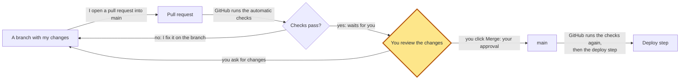

**How it's switched on:** a rule on GitHub (a *ruleset*) for `main` that
requires a pull request and passing checks, and blocks direct pushes. Only
you can create it. **GitHub never lets the author of a pull request approve
it**, and my changes go up under your GitHub login, so the pull requests
are yours. A rule requiring "1 approval" would block every merge. Instead,
**your click on Merge is the approval**: I never merge, so nothing reaches
`main` without you. Formal "Approve" reviews would need a second GitHub
account for my changes.

## §10 · Automatic checks on every change

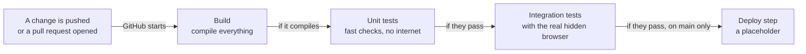

Each stage runs only if the one before passed. They run on a fresh Ubuntu
24.04 machine each time.

## §11 · Measuring how accurate extraction is

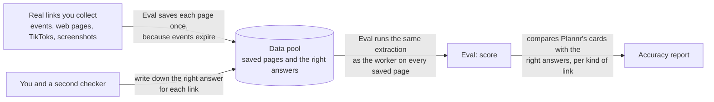
