# Plannr architecture

How Plannr's parts fit together. Section 1 explains the words; section 2
is the whole system at a glance; section 3 walks through every step of
sharing a link; the sections after that zoom in on one topic each. On
every diagram, **each arrow says what it does**.

**Numbering:** the five **groups** of the system are numbered **1-5**
(1 phone, 2 server, 3 database, 4 worker, 5 outside services), and the
parts inside a group are **1a, 2c** and so on. The steps of sharing a link
are **① to ⑱**, in order. **Yellow** marks the option chosen, or the part to look at.

## §1 · Words used on this page

| Word | What it means here |
|---|---|
| **AI client** | The part of the worker that sends text or a screenshot to Groq and reads back its answer. |
| **Announcer** | The part of the server that tells your phone a capture has finished: a live message if the app is open, a push notification if it isn't. |
| **API** | The set of addresses the server answers on. The phone app uses it to send and fetch things over the internet. "The server" and "the API" are used to mean the same program. |
| **APK** | The installable app file for Android. |
| **Branch** | A separate line of changes in git, kept apart from `main` until it's merged. |
| **Capture** | **One thing you shared** (a link or a screenshot) and its progress towards becoming a card: *waiting*, *processing*, *done* or *failed*. Each capture is a row in the captures table. |
| **Card** | **The result of a capture:** an activity with its title, date and time, place, price and description. You can edit it, keep it, or send it to a group. |
| **Chromium** | A real web browser with no window, used for pages that only show their content after running JavaScript. Playwright is the library that drives it. |
| **CI** | Automatic checks that GitHub runs on every change: build the code and run the tests. |
| **Claim** | A worker saying "this capture is mine": the server marks it *processing* for that worker, in one step, so two workers can never take the same one. |
| **Data pool** | A saved set of real links, with the correct answers written down by hand, used to measure how accurate Plannr's reading is. |
| **Database** | Where everything is stored, in tables (MySQL). Only the server reads and writes it. |
| **Dependency injection** | The program is told at start-up which real or fake version of each part to use, instead of each part creating its own. This is what lets tests swap in fakes. |
| **Development build** | Your own copy of the app, installed on your phone, that still loads its code live from the laptop while we work on it. |
| **Endpoint** | One address on the API that does one job, such as "accept a shared link". |
| **Error reference** | A short code shown with an error, such as `7f3a9c21:02:01`, that finds the matching line in the log. |
| **Eval** | A command-line tool on the laptop that runs the same extraction as the worker, for testing and measuring accuracy. |
| **Expo** | A toolkit for building phone apps with React Native: ready-made modules plus a build service (EAS). |
| **Expo push service** | Expo's servers, which deliver notifications to phones. |
| **Extraction pipeline** | The fixed sequence of steps that turns a capture into a card: fetch the content, read its hidden details, ask the AI for what's missing, check and tidy the answer, add flags. |
| **Fake** | A stand-in used in tests in place of something outside, for example an AI that returns prepared answers without using the internet. |
| **Flag** | A marker on one field of a card that Plannr isn't sure about (missing, uncertain or unreadable), highlighted for you to check. |
| **Groq** | The company whose servers run the AI (the LLM) Plannr uses. |
| **Group** | Friends who plan together in Plannr. |
| **Hand-off** | Passing work between the server and the worker. The **job hand-off** takes a new capture to the worker; the **result hand-off** brings the finished card back to the server, and so to your phone. |
| **Idempotent** | Safe to repeat: doing it twice has the same effect as doing it once. The worker's "here's the card" is, so it can simply send again if it hears no answer. |
| **Interface** | A description of what a part must be able to do, without saying how. Code that uses an interface works with any part that fits it, real or fake. |
| **Internal endpoints** | Endpoints only the worker may call (`/internal/...`): claim a job, hand back a result. Guarded by the shared secret. |
| **Job loop** | The worker's main loop: claim waiting captures from the server while it has a free slot, run them, and otherwise wait for a nudge or the sweep. |
| **JSON-LD** | Event details that many websites hide in their pages for search engines: name, date, venue, price, in a standard machine-readable form. |
| **Lease** | How long a claim lasts (5 minutes). If the worker goes quiet for longer (it crashed or restarted), the capture can be claimed again. |
| **Library** | Code that never runs on its own; it's built into programs that use it. |
| **Live updates hub** | The part of the server that keeps a connection open to each running app, so it can tell the app about changes instantly (SignalR). |
| **LLM** | Large language model: an AI that reads text (or images) and answers questions about it. |
| **main** | The main branch: the version of the code that counts. |
| **Nudge** | A tiny "look now" message: the server nudging the worker after saving a capture, or the result endpoint nudging the announcer. Losing one only costs time, never data. |
| **Open Graph tags** | A title, description and image hidden in a web page so link previews look right. |
| **Plan** | A card sent to a group to agree a date. |
| **Program** | Code that runs on its own: the phone app, the server, the worker, Eval, the database. |
| **Pull request** | A request on GitHub to merge a branch into `main`, where the changes can be checked and approved. |
| **Push notification** | A message that appears on your phone when the Plannr app isn't open. |
| **React Native** | A way to write a phone app in TypeScript that turns into real Android screens. |
| **Response** | A group member's yes or no to a plan. |
| **Retriever** | The part that fetches the content for one kind of link: web pages, TikTok, YouTube. |
| **Safety guard (SSRF)** | A check that stops a shared link from pointing the server at its own private network. |
| **Scraping** | Reading a web page's content automatically. |
| **Server** | A computer on the internet, and the program running on it, that the app talks to. Plannr's server program is `Plannr.Api`. |
| **Share sheet** | The list of apps your phone shows when you tap Share. |
| **Shared secret** | A long random password that the server and the worker both know. Every internal request carries it; anything without it is refused. |
| **Slot** | A place for one job in the worker. With 2 slots, at most 2 captures run at once. |
| **Sweep** | A slow, regular check (the worker every 45 s, the announcer every 30 s) that finds anything a lost nudge missed. |
| **Wishlist** | All your saved cards. |
| **Worker** | A second server program that does the slow work (fetching pages, asking the AI) in the background, so the server can always answer quickly. |

## §2 · The system at a glance

The five groups, and what passes between them. **Only the server touches
the database:** the worker gets its jobs from the server and hands its
cards back to it. Section 3 opens each group up into its parts.

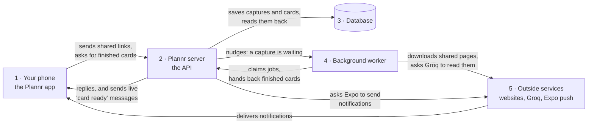

## §3 · Sharing a link, step by step

Every part of every group has its own column, under its group's heading.
The steps run **top to bottom, ① to ⑱**; each one starts where the one
before it ended. Solid arrows are requests, dashed arrows are the replies,
and an open arrowhead is a nudge: sent without waiting for an answer.

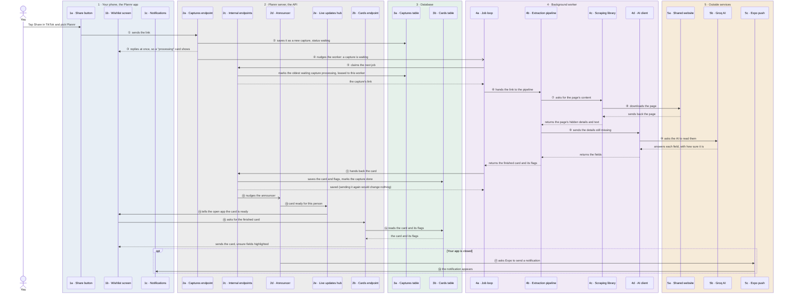

| Step | Arrow | What happens |
|---|---|---|
| ① | 1a → 2a | You tap Share in TikTok (or a browser, or your photos) and pick Plannr. The app sends the link to the server. |
| ② | 2a → 3a | The server checks it's a kind of link Plannr can read, then saves it as a new **capture** with the status *waiting*. |
| ③ | 2a → 1b | The server replies straight away, without waiting for the slow part, so your wishlist shows a "processing" card at once. |
| ④ | 2a → 4a | The server **nudges** the worker: "a capture is waiting". It doesn't wait for an answer; if the nudge is lost, the worker's sweep finds the capture within 45 seconds. |
| ⑤ | 4a → 2c | The worker **claims** the next job. In one step, the server marks the oldest waiting capture *processing*, leased to this worker, and sends back its link. |
| ⑥ | 4a → 4b | The job loop hands the link to the extraction pipeline. |
| ⑦ | 4b → 4c | The pipeline asks the scraping library for the page's content. |
| ⑧ | 4c → 5a | The scraping library downloads the page, using the hidden browser only if the page needs JavaScript, and returns the page's hidden event details and text. |
| ⑨ | 4b → 4d | The pipeline reads the hidden event details itself, then sends whatever is still missing to the AI client. |
| ⑩ | 4d → 5b | The AI client asks Groq to read the content and gets back each field with how sure it is. The pipeline checks and tidies the answer and adds flags. |
| ⑪ | 4a → 2c | The worker **hands back** the card. The server saves it with its flags and marks the capture *done*. If the worker hears no answer it sends again: the server keeps the first copy. |
| ⑫ | 2c → 2d | The server nudges its announcer. |
| ⑬ | 2d → 2e | The announcer passes "card ready for this person" to the live updates hub. |
| ⑭ | 2e → 1b | The hub tells your app, if it's open, that the card is ready. |
| ⑮ | 1b → 2b | The app asks the server for the finished card. |
| ⑯ | 2b → 3b | The server reads the card and its flags and sends them back; the app shows the card with unsure fields highlighted. |
| ⑰ | 2d → 5c | If your app is closed, the announcer asks Expo's push service to send a notification instead. |
| ⑱ | 5c → 1c | The notification appears on your phone. |

If anything fails (the page won't load, Groq is down), step ⑪ hands back
a *failure* instead of a card, with a message for you and an error
reference, and steps ⑫-⑱ tell your phone in the same way.

## §4 · Hand-offs between the server and the worker

The card is made **inside the worker** (group 4), but the database and
your phone's live connection belong to the **server** (group 2). They are
separate programs, usually on separate machines, so work has to be handed
across twice: the **job hand-off** (a new capture to the worker, steps
④-⑤) and the **result hand-off** (the card back to the server and on to
you, steps ⑪-⑬). Both work the same way, called **nudge and sweep**:

- **The database row is the truth.** A capture's status is only ever in its row, so a crash anywhere loses nothing: the row says what's left to do.
- **The nudge makes it fast.** Whoever changes a row tells the other side to look *now*.
- **The sweep makes it safe.** Each side also looks on a timer, so a lost nudge costs seconds, never a card.

**Job hand-off:** a new capture reaches the worker.

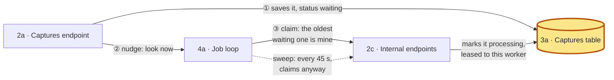

**Result hand-off:** the card reaches your phone.

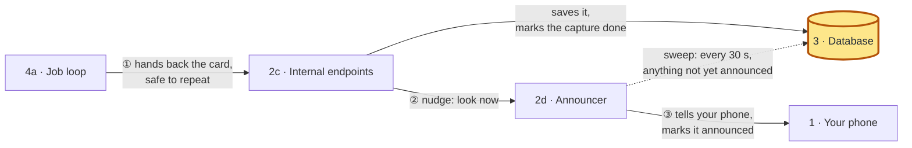

**When something goes wrong:**

| What goes wrong | What happens |
|---|---|
| The nudge to the worker is lost (the worker was restarting) | The capture waits in the table; the worker's sweep claims it within 45 seconds. |
| The worker crashes halfway through a job | Its lease runs out after 5 minutes and the capture is claimed again. After 3 tries it's marked *failed*, with a message for you. |
| Two workers claim at the same moment | The claim is one step inside the database: one worker gets the capture, the other gets the next one, or nothing. |
| The worker hears no answer when it hands back a card | It sends again. The server saves the first copy and ignores the rest. |
| The server restarts before telling you | The capture is *done* but not yet announced; the announcer's first round after the restart tells you. |
| Your app is closed | The announcer asks Expo for a push notification instead of a live message. |
| Anyone else calls an internal endpoint | Refused: they don't have the shared secret. |

**Why not simpler?** If the server waited for the worker to finish
before answering your phone, every share would hang for 10 to 60 seconds,
and phones and load balancers give up on requests that slow. Checking the
table every 2 seconds instead of nudging would add delay and a query every
2 seconds for ever; a message service (Redis) would be one more thing to
run and pay for. How each piece is built, step by step:
[`guides/hand-offs.md`](guides/hand-offs.md). The decision: D37.

## §5 · Programs and libraries

**A library isn't a service, so nothing talks to it through an API.**
It's code built into each program that uses it, called like any other
function, inside the same running program. Separate programs, like the
server and the worker, can't call each other's functions: they meet only
through the server's **internal endpoints**, over HTTP.

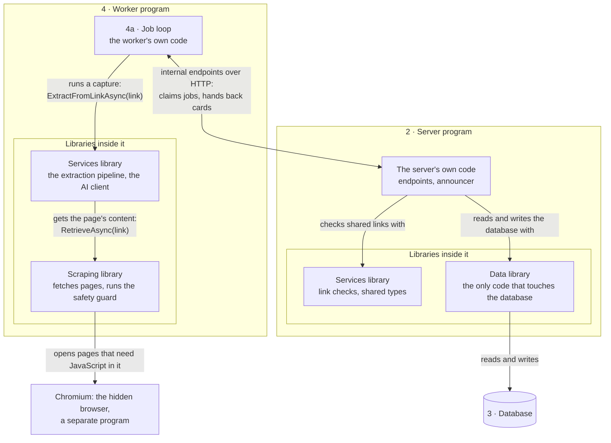

**Why scraping is its own library:** the browser code is large (about
130 MB with its driver) and the server never opens a web page. Kept in a
library that **only the worker and Eval use**, the server stays small and
quick to deploy, and **can't** run browser code even by mistake, so a
crashed browser can never take the server down.

**Why the database is its own library, used only by the server:** the
worker can't open a database connection even by mistake, so there's one
program to secure and one set of rules for changing a capture. Inside the
server, the endpoints go through the Data library's repositories, one per
table, rather than writing queries of their own.

## §6 · Which part may use which

Arrows point at the code being used. `ArchitectureTests` fails the build
on any other arrow, and on network calls in the Services library anywhere
but its `APIs/` folder (D41, D42).

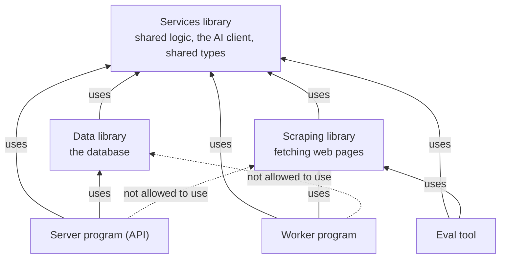

## §7 · Outside connections behind interfaces

**The rule:** everything that reaches outside the program sits behind an
interface. The real program is set up to use the real thing; tests are set
up to use a fake, through the same dependency injection. The code in the
middle only knows the interface, so it works with either.

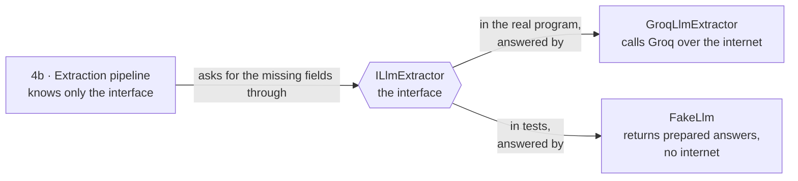

| Outside thing | Interface | Real version | Test version |
|---|---|---|---|
| Web pages | `IPageFetcher` | `HttpPageFetcher` | serves saved pages |
| The hidden browser | `IBrowserPageFetcher` | `PlaywrightPageFetcher` | returns prepared HTML |
| Groq | `IGroqApi`, `ILlmExtractor` | Groq over HTTPS | prepared answers |
| The server, from the worker | `IPlannrInternalApi` | the server's internal endpoints | hands out prepared jobs, records results |
| The worker, from the server | `IWorkerWakeApi` | the worker's wake endpoint | records the nudge |
| The clock | `TimeProvider` | the real clock | a clock the test moves |
| Address lookups (DNS) | `IHostResolver`, still to be added: the safety guard calls DNS directly | the real DNS | prepared addresses |
| The database | one interface per table (`ICaptureRepository`, ...) | MySQL | records what was asked |
| Telling the phone | `INotificationService` | live updates hub + Expo push | records what was sent |
| Expo push | `IExpoPushApi` | Expo over HTTPS | records what was sent |
| TikTok | `ITikTokOEmbedApi` | TikTok over HTTPS | prepared captions |
| YouTube | `IYouTubeDataApi` | YouTube over HTTPS | prepared descriptions |

## §8 · Getting the app onto your phone

**Three layers.** We write the app in TypeScript. **React Native** turns
our screens into real Android screens. **Expo** adds ready-made modules
(notifications, secure storage, share handling) and **EAS**, its free build
service, which makes the installable app file (the **APK**) so you don't
need Android Studio.

An Android app has two parts:
- a **native part**, fixed at the moment the app file is built. It includes the app's *manifest*, which tells Android what the app can do, such as "I accept shared links";
- a **JavaScript part**: our code, which can be swapped while developing.

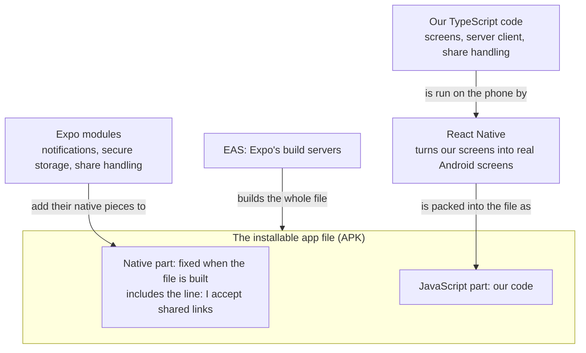

**Why the share sheet decides everything.** When you tap Share in TikTok,
Android looks through every installed app's manifest for "I accept shared
text" and lists those apps. Plannr only appears if **its own** manifest
says so.

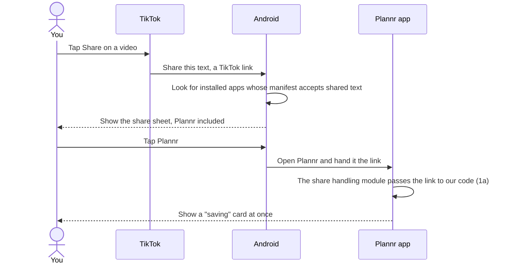

**Three ways to run the app:**

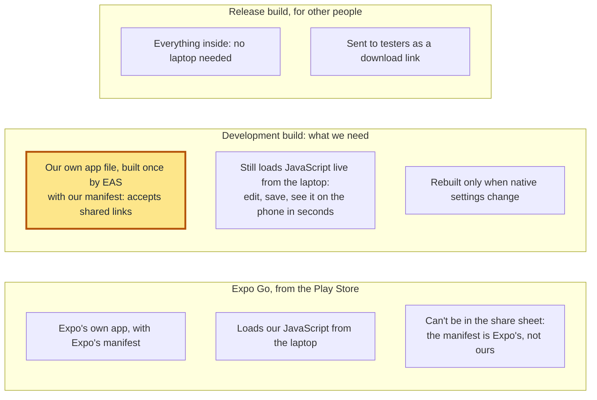

**How the development build reaches your phone:**

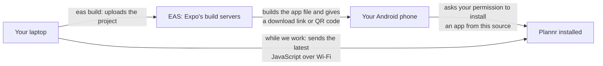

## §9 · Approving changes before they reach `main`

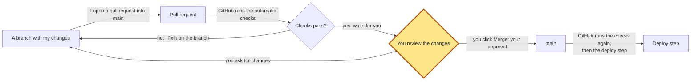

**How it's switched on:** a rule on GitHub (a *ruleset*) for `main` that
requires a pull request and passing checks, and blocks direct pushes. Only
you can create it. **GitHub never lets the author of a pull request approve
it**, and my changes go up under your GitHub login, so the pull requests
are yours. A rule requiring "1 approval" would block every merge. Instead,
**your click on Merge is the approval**: I never merge, so nothing reaches
`main` without you. Formal "Approve" reviews would need a second GitHub
account for my changes.

## §10 · Automatic checks on every change

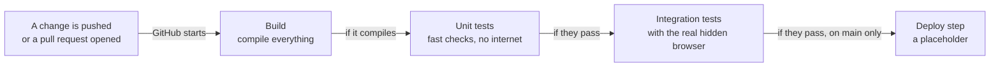

Each stage runs only if the one before passed. They run on a fresh Ubuntu
24.04 machine each time.

## §11 · Measuring how accurate extraction is

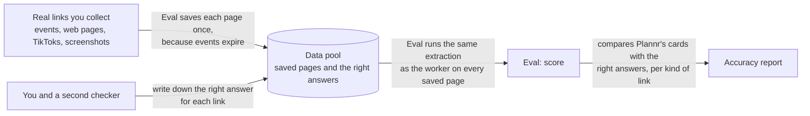
