# Plannr architecture

One big overview with labelled parts, then a detail diagram per topic. The
labels (**P1**, **A4**, **W3** ...) and step numbers (**①** ...) are what the
other docs and our conversations point at. Yellow boxes are the parts the
open questions are about.

GitHub draws these diagrams (they're written in Mermaid); the same page is
also published as an artifact for reading in the app.

## §1 · Overview: the whole system

Two kinds of boxes matter:
- **Programs** run on their own: the phone app, `Plannr.Api`, `Plannr.Worker`, `Plannr.Eval`, MySQL, Chromium.
- **Libraries** (`Plannr.Core`, `Plannr.Infrastructure`, the planned `Plannr.Infrastructure.Scraping`) never run on their own; they're compiled into programs (§4).

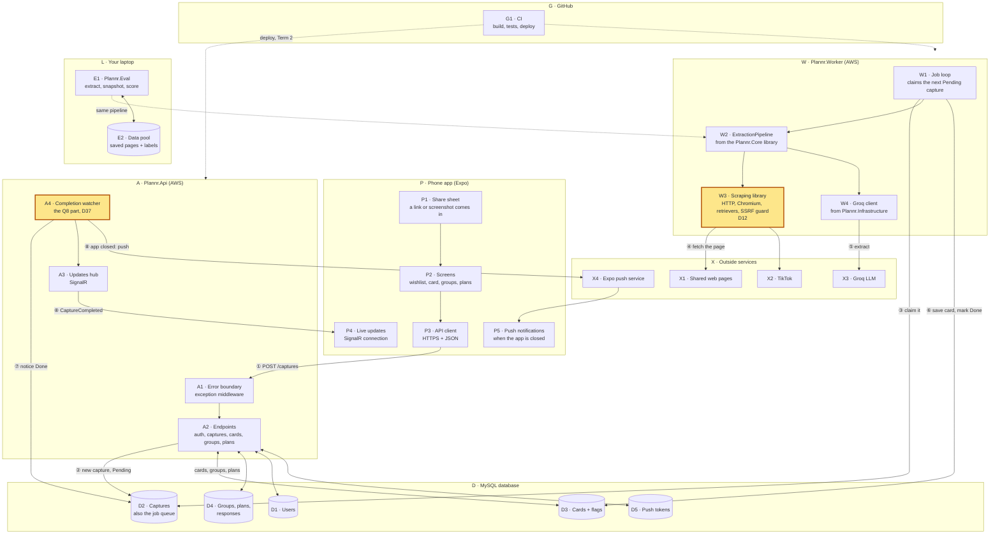

| Step | What happens |
|---|---|
| ① | You share a link; the app sends it to the API. |
| ② | The API checks it's a link Plannr can read (instant), stores it as a **Pending capture**, and answers straight away. The app shows a "processing" card. |
| ③ | The Worker, checking every second or two, claims the capture. |
| ④ | It fetches the page (plain HTTP, or Chromium for JavaScript pages). |
| ⑤ | It maps the page's own event data by code and asks Groq only for what's missing. |
| ⑥ | It saves the card and its flags, and marks the capture **Done** (or **Failed**, with a message and an error reference). |
| ⑦ | The API finds out the capture is done. **How is question 8** (§3). |
| ⑧ | The API tells your phone: instantly over the live connection if the app is open, or as a push notification if it's closed. |

## §2 · Sharing a link, end to end

The same journey as §1 ①-⑧, in time order. The yellow band is the part
question 8 is about.

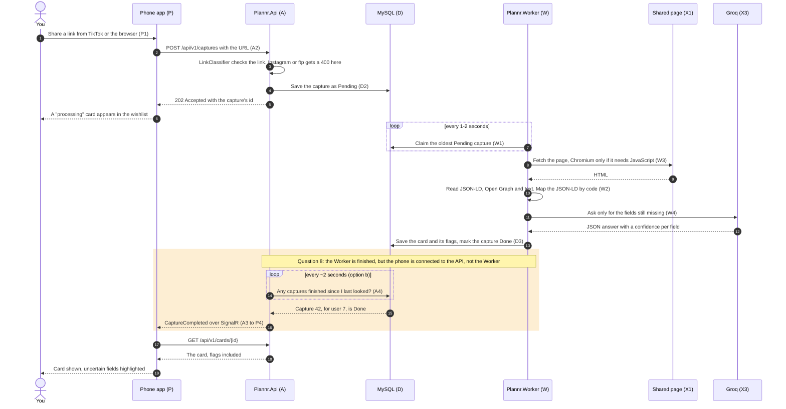

If anything fails (the page won't load, Groq is down), the Worker marks the
capture **Failed** with a message for you and an error reference, and the
same yellow-band path tells the phone.

## §3 · Question 8: how the API learns a card is ready

**The problem in one line:** the card is finished **inside the Worker**
(§1 W), but your phone's live connection is to the **API** (§1 A3), and the
two are separate programs, usually on separate machines. Something has to
carry "capture 42 is done" from one to the other (§1 ⑦).

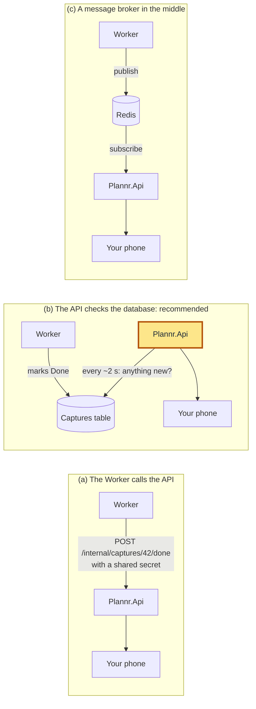

| | (a) Worker calls the API | **(b) API checks the database** | (c) Message broker |
|---|---|---|---|
| Delay | Instant | Up to ~2 s (the card itself takes several seconds anyway) | Instant |
| New things to build | An internal endpoint, and a secret to stop anyone else calling it on a public API | A small background loop in the API | A Redis server to run and pay for |
| If the API restarts | The Worker's call fails: retry logic needed | Nothing lost: it picks up where it left off | Messages can be lost unless stored |
| Two copies of the API (AWS scaling) | Only the copy that got the call tells its phones; others miss it | **Works:** each copy checks and tells its own connected phones | Works |

## §4 · Programs and libraries: where scraping lives (D12)

**Short answer: the scraping project is a C# library, not a separate service,
so nothing talks to it through an API.** A library is a `.dll` of code that's
**compiled into** a program. The Worker calls it with ordinary method calls
inside its own process, as fast as calling any other function. Separate
programs (the API and the Worker) can't call each other's methods; they
communicate through something shared, here the database.

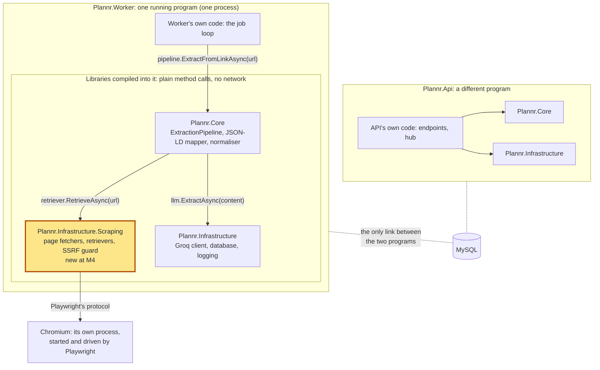

**Why split scraping out of `Plannr.Infrastructure` at all:** today the API
references Infrastructure, which contains the Playwright code, so the API's
build carries Playwright's ~130 MB driver though it never opens a page. Once
scraping is its own library that **only the Worker and Eval reference**:
- the API's Docker image is smaller and quicker to deploy, with fewer packages to keep patched;
- the API **can't** call browser code even by mistake (the compiler won't find it), which enforces the plan's rule that a crashed browser mustn't take the API down.

Which project may use which (arrows point at what's used):

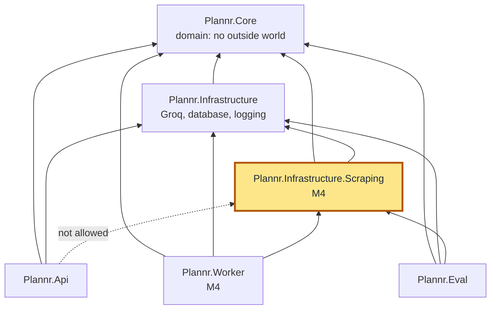

## §5 · Outside connections behind interfaces (D40)

Your rule, as in Applr: **everything that talks to the outside world sits
behind an interface**, so `Program.cs` registers the real thing and tests
register a fake through the same dependency injection. The code that uses it
only ever sees the interface.

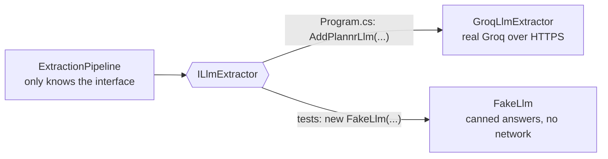

| Outside thing | Interface | Real (Program.cs) | Fake (tests) | Status |
|---|---|---|---|---|
| Web pages over HTTP | `IPageFetcher` | `HttpPageFetcher` | `FixtureFetcher`, stub HTTP handler | built |
| Chromium | `IBrowserPageFetcher` | `PlaywrightPageFetcher` | `FakeFetcher` | built |
| Groq | `IGroqApi` (Refit), `ILlmExtractor` | Refit client, `GroqLlmExtractor` | `FakeGroqApi`, `FakeLlm` | built |
| The clock | `TimeProvider` | `TimeProvider.System` | `FakeTimeProvider` | built |
| DNS (the SSRF guard's lookup) | none yet: calls `Dns` directly | | the address check is tested directly | **gap: add `IHostResolver`** |
| MySQL | one repository interface per table (D34) | EF Core repositories | in-memory fakes / test database | M3+ |
| Job queue | `ICaptureQueue` | `MySqlCaptureQueue` | in-memory queue | M4 |
| Telling the phone | `INotificationService` | SignalR + Expo push | recording fake | M4 |
| Expo push | `IExpoPushApi` (Refit) | Refit client | fake | M7 |
| TikTok oEmbed | `ITikTokOEmbedApi` (Refit) | Refit client | fake | M6 |
| YouTube Data API | `IYouTubeDataApi` (Refit) | Refit client | fake | T2 |

## §6 · Getting the app onto your phone (question 13, from first principles)

**Three layers.** We write the app in **TypeScript**. **React Native** turns
our screens into real Android screens (not a web page in a browser).
**Expo** is a toolkit on top: ready-made modules (notifications, secure
storage, calendar, share handling) and **EAS**, a free cloud service that
builds the installable Android app (an **APK**) so you don't need Android
Studio.

An Android app has two parts:
- a **native part**, fixed at the moment the app is built. It includes the app's *manifest*, which tells Android what the app can do, such as "I can receive shared links";
- a **JavaScript part**: our code, which can be swapped while developing.

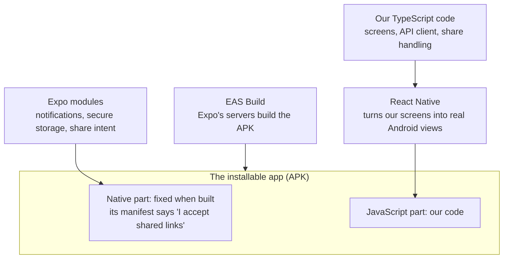

**Why the share sheet decides everything.** When you tap *Share* in TikTok,
Android looks through every installed app's manifest for "I accept shared
text" and lists those apps. Plannr only appears if **its own** manifest
says so:

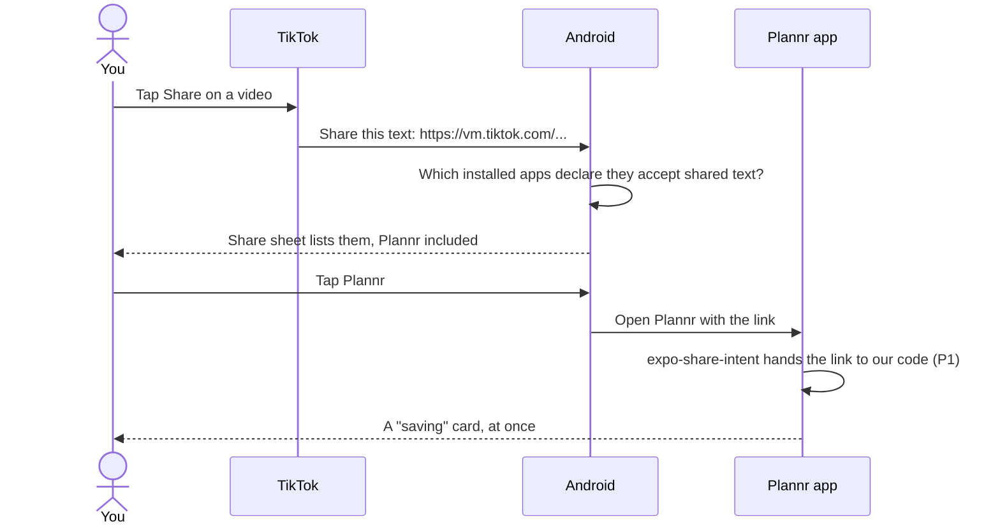

**Three ways to run the app:**

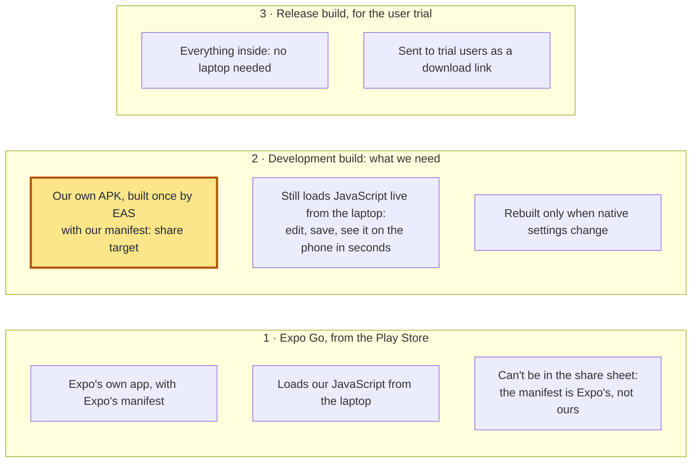

**How the development build reaches your phone:**

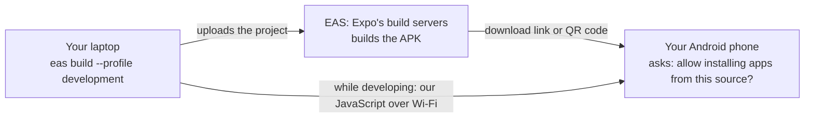

**So the three things I asked for are:**
1. **A free account at expo.dev**: EAS builds run under it.
2. **Your Android version** (Settings → About phone): to check the share-intent module supports it.
3. **Whether your phone lets you install an app from a download link**: Android asks for permission ("install unknown apps"); some work or school-managed phones block it.

## §7 · Your approval before anything reaches `main`

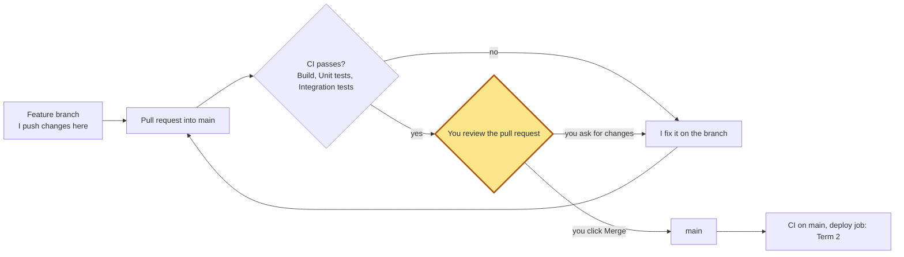

**It isn't set up yet;** it needs the ruleset from our chat, which only you
can create. One GitHub detail decides how: **GitHub never lets the author of
a pull request approve it**, and my commits are pushed with your git login,
so the pull requests are yours. A rule of "1 approval required" would
therefore block every merge. Instead:
- the ruleset requires a **pull request** and **passing CI** for `main`, and no direct pushes;
- **your click on Merge is the approval**: I never merge, so nothing reaches `main` without you.

If you later want formal "Approve" reviews, the usual way is a second GitHub
account for automated changes.

## §8 · CI pipeline

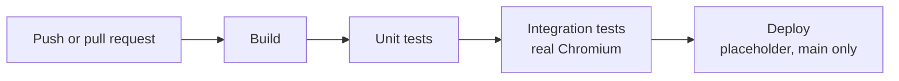

Each stage waits for the one before and is skipped if it fails. The runner
is pinned to Ubuntu 24.04 (D31).

## §9 · The data pool and scoring (M2, next)

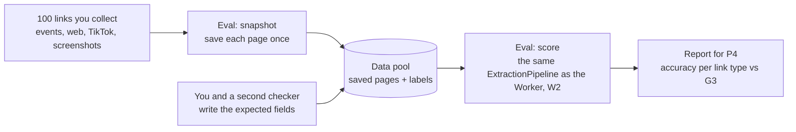
