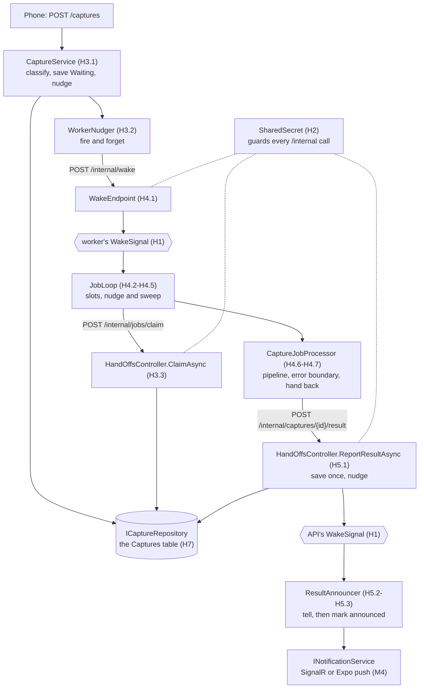

# Building the hand-offs

The two **hand-offs between the server and the worker** (D37), built with
**nudge and sweep**:

- **Job hand-off:** a link you shared, saved by the server (`Plannr.Api`), gets to the worker (`Plannr.Worker`).
- **Result hand-off:** the card the worker made gets back to the server, which tells your phone.

The skeleton is in place. Every class, method and test exists and builds;
the logic is marked `TODO(Hx.y)` and throws `NotImplementedException` until
you write it. Each TODO's tests are already written (and were checked
against a working version), skipped until you un-skip them. This page gives
the order to write them in, how the pieces connect, and the C# tools each
one needs. Diagrams of the whole flow: [`architecture.md`](../architecture.md) §3-§4.

## The idea in four sentences

1. **The database row is the truth.** A capture's status (*waiting*, *processing*, *done*, *failed*) is only ever in its row, so a crash anywhere loses nothing: the row says what's left to do.
2. **The nudge makes it fast.** Whoever changes a row rings the other side's doorbell (a `WakeSignal`) so it looks *now*.
3. **The sweep makes it safe.** Every loop also looks on a timer, so a lost nudge only costs a few seconds.
4. **Only the server touches the database** (D41). The worker claims jobs and hands back results through the server's private `/internal` endpoints, each a request of a few milliseconds.

## How the pieces connect

Each box is a class; the label in brackets is the TODO that writes it.



| Piece | Project, file | TODOs | Its tests |
|---|---|---|---|
| The doorbell | Services `HandOffs/WakeSignal.cs` | H1.1-H1.3 | `WakeSignalTests` |
| The secret check | Services `HandOffs/SharedSecret.cs`, Api `HandOffs/RequireSharedSecretAttribute.cs` | H2.1, H2.2 | `SharedSecretTests` |
| Accepting a link | Api `Services/CaptureService.cs` | H3.1 | `ApiJobHandOffTests` |
| Nudging the worker | Api `HandOffs/WorkerNudger.cs` | H3.2 | `ApiJobHandOffTests` |
| The claim endpoint | Api `Controllers/HandOffsController.cs` | H3.3 | `ApiJobHandOffTests` |
| The wake endpoint | Worker `HandOffs/WakeEndpoint.cs` | H4.1 | `WorkerJobHandOffTests` |
| The job loop | Worker `HandOffs/JobLoop.cs` | H4.2-H4.5 | `WorkerJobHandOffTests` |
| One job | Worker `HandOffs/CaptureJobProcessor.cs` | H4.6, H4.7 | `CaptureJobProcessorTests` |
| The result endpoint | Api `Controllers/HandOffsController.cs` | H5.1 | `ApiResultHandOffTests` |
| The announcer | Api `HandOffs/ResultAnnouncer.cs` | H5.2, H5.3 | `ApiResultHandOffTests` |
| The wiring | Worker and Api `HandOffs/HandOffServiceCollectionExtensions.cs`, Api `Program.cs` | H6.1-H6.3 | `HandOffWiringTests` |
| The MySQL claim | Data `Repositories/CaptureRepository.cs`, `Configurations/CaptureConfiguration.cs` | H7.1, H7.2 | (written with M3) |

**Already written for you, so the TODOs have something to stand on:** the
messages (`DTOs/HandOffDtos.cs`), the Refit clients (`APIs/IPlannrInternalApi.cs`,
`APIs/IWorkerWakeApi.cs`, registered in `DependencyInjection/HandOffServiceCollectionExtensions.cs`),
the `Capture` row and `ICaptureRepository`, both programs' options, and
the worker's `Program.cs`. `HandOffContractTests` (not skipped) proves a
message one program sends is one the other can read.

## Working through a TODO

1. Read the TODO comment in the code: it says what to write and with which tools. This page says why.
2. Where it says *make the method async*, add `async` to the signature (and remove the `throw` once you're done).
3. Write it; delete the TODO comment and the `throw new NotImplementedException(...)`.
4. Un-skip its tests: search the tests for its constant (`Todo.H1_3`, say) and delete `(Skip = Todo.H1_3)` from each.
5. Run just those tests, for example:
   ```bash
   dotnet test backend/tests/Plannr.Tests --filter "FullyQualifiedName~WakeSignalTests"
   ```
6. Green: tick it in the checklist at the bottom (`- [x]`). `HandOffGuideTests` checks the two agree: a TODO still in the code must be unticked here, and a ticked one must be gone from the code.

**The order matters:** each step uses the ones before it (the job loop sleeps on the doorbell, the endpoints check the secret), so go H1, H2, ... H6. H7 comes with the database in M3.

The skeleton keeps what each constructor is given in a field (`_captures`,
`_options` ...): use those. (A constructor parameter nobody reads is a
compiler warning, and warnings fail the build here.)

---

## H1 · The doorbell (`WakeSignal`)

**What it's for:** both loops (the worker's job loop, the API's announcer)
spend most of their time waiting. The signal lets them wait for *either*
"someone rang" *or* "the sweep interval passed", whichever comes first.

**Tools:**
- **`Channel<T>`** (`System.Threading.Channels`): a thread-safe queue with waiting built in. One side writes (`Writer.TryWrite`), the other reads (`Reader.TryRead`) or waits for something to read (`Reader.WaitToReadAsync`). **Bounded to 1 with `DropWrite`**: there's room for one item, and a write into a full channel is dropped, so three rings before the loop wakes are one wake. That's right here: a wake means "go and look", and one look sees everything.
- **`Task.WhenAny(a, b)`**: a task that finishes when the first of `a` or `b` does, and hands you back which one it was. This is how you race the doorbell against the timer.
- **`Task.Delay(interval, timeProvider, token)`**: the timer. Passing a `TimeProvider` lets the tests use a fake clock (`FakeTimeProvider.Advance`) instead of really waiting 45 seconds.
- **`CancellationTokenSource.CreateLinkedTokenSource(token)`**: a token that cancels when the caller's token does, *or* when you cancel it yourself. Cancel it once you have a winner, so the losing wait doesn't linger.

**Watch out for:** start the delay before you `await` anything, or the fake
clock can move before the timer exists. And `await` the winner even though
it's finished: if it was cancelled, that's what rethrows the cancellation to
the caller.

## H2 · The shared secret

**What it's for:** `/internal` endpoints are reachable over the network, so
each side refuses a request that doesn't carry the secret both were
configured with.

**Tools:**
- **`CryptographicOperations.FixedTimeEquals(a, b)`** on the UTF-8 bytes (`Encoding.UTF8.GetBytes`). An ordinary `==` stops at the first wrong character, so a fast "no" means the first character was wrong: an attacker can time the answers and guess the secret one character at a time. Fixed-time comparison takes as long whatever matches.
- **An authorization filter** (`IAuthorizationFilter`, H2.2) runs before the action. Setting `context.Result` answers the request there, and the action never runs. Attributes are created by the framework, not by dependency injection, so the filter fetches the options from `context.HttpContext.RequestServices`.

## H3 · Job hand-off, the server's side

- **H3.1 `CaptureService.AcceptLinkAsync`:** classify, save, nudge, **in that order**. Classify first, so a bad link is refused before anything is saved. Nudge last, so the worker never wakes to an empty table.
- **H3.2 `WorkerNudger.Nudge`:** *fire and forget*. The phone's request must never wait for the worker, and must never fail because the worker is down: the capture is safe in the database, and the sweep will find it. `Task.Run(SendAsync)` starts the call on another thread; `_ =` says "I'm deliberately not awaiting this". Because nobody awaits it, `SendAsync` must catch everything itself, or an exception would vanish unseen.
- **H3.3 the claim endpoint:** a thin pass-through. Choosing *which* capture, atomically, is the repository's job (H7.1); the endpoint turns "none" into **204 No Content** and a capture into a `ClaimedCapture`.

## H4 · Job hand-off, the worker's side

- **H4.1 the wake endpoint:** a *minimal API* handler. ASP.NET Core fills its parameters in: the `HttpRequest` from the call, `WakeSignal` and `WorkerOptions` from dependency injection. Check the secret, then ring.
- **H4.2 the slots: `SemaphoreSlim`.** A counter of free places. `WaitAsync(0)` takes one *only if one is free now*, and answers true or false; `Release()` gives one back; `CurrentCount` says how many are free. With 2 slots, at most 2 captures (and 2 Chromium pages) run at once.
- **H4.3 the loop: `BackgroundService.ExecuteAsync`.** The host calls it once at start-up and cancels `stoppingToken` at shutdown. The shape is *do a round, then wait for a nudge or the sweep*, for ever. **`catch (Exception e) when (e is not OperationCanceledException)`**: an *exception filter* catches everything except the shutdown signal, so the loop survives the API being down and still stops when told. The `finally` waits for running jobs by taking every slot back.
- **H4.4 one round:** claim while a slot is free. Every path out must leave the slot count right: a failed claim gives its slot back before rethrowing (`throw;` keeps the original stack trace), and "nothing waiting" gives it back too. A job keeps its slot; `Task.Run(() => RunJobAsync(...))` starts the job beside the loop instead of inside it.
- **H4.5 one job:** `IServiceScopeFactory.CreateScope()` gives this job its own set of short-lived services, its own processor and HTTP client, which are thrown away when the `using` ends. A long-lived class (the loop lives as long as the program) must never keep short-lived ones itself. `finally` always gives the slot back and rings the doorbell: a slot just came free, so look for more work now.
- **H4.6 the error boundary:** the one place a job's failures become something the user sees. **Catch order matters:** C# uses the first `catch` that fits, so cancellation goes first (shutting down isn't a failure), then `CaptureException` (an expected outcome for some links: show its `UserMessage`, log a warning), then `Exception` (a bug: show a plain message, log an error). Each failure gets an `ErrorReference` that finds this worker's log line.
- **H4.7 handing back, with retries:** the result endpoint ignores a second copy, so **retrying is safe**. Retry what's likely to clear up (couldn't connect, a timeout, a 5xx), not what won't (a 4xx means wrong secret or bad shape: it would fail the same way). Wait a little longer each time. If it never gets through, give up quietly: the lease runs out and the capture runs again. `IsWorthRetrying` is a **switch expression** with type patterns (`HttpRequestException => true`) and a property pattern on Refit's `ApiException`.

## H5 · Result hand-off, the server's side

- **H5.1 the result endpoint:** check the shape, find the capture, and if it's already finished answer 200 and change nothing. That's what makes it **idempotent** (safe to repeat): a worker that didn't hear the first answer can simply send again, and "the first result wins". Then save, and ring the announcer.
- **H5.2 the announcer's loop:** the same shape as H4.3, without slots. Its first round runs before its first wait, so anything left unannounced when the API restarted goes out at once.
- **H5.3 one round:** a scope for the repository (as in H4.5), then each finished capture: **tell first, then mark announced**. A crash in between means telling twice, which beats never telling. Each capture in its own `try`/`catch`, so one user's failed push doesn't hold up everyone else's.

## H6 · The wiring

**Lifetimes** (how long dependency injection keeps each thing):
- **Singleton:** one for the whole program. The `WakeSignal` must be one: the endpoint that rings it and the loop that waits on it have to get the *same* object.
- **Scoped:** one per request (or per scope you create). Repositories are scoped: one database context per piece of work. A singleton must never hold a scoped service (`ValidateScopes` in the tests catches it).
- **Transient:** a new one every time it's asked for. The job processor, so each job gets its own.
- **Hosted service** (`AddHostedService<T>`): the host starts it with the program and stops it at shutdown.

- **H6.1** the worker (`AddPlannrWorkerHandOffs`; the worker's `Program.cs` already calls it).
- **H6.2** the API (`AddPlannrApiHandOffs`). It needs the repositories (M3) and a notifier (M4) to run for real; its test registers fakes for both.
- **H6.3** the one line in the API's `Program.cs`, once M3 and M4 exist.

**The secret** (the same value in both programs; never in a committed file).
Make one in PowerShell:
```powershell
[Convert]::ToBase64String([Security.Cryptography.RandomNumberGenerator]::GetBytes(32))
```
Then set it in each program, from the repository root:
```bash
dotnet user-secrets set "Worker:Secret" "<the value>" --project backend/src/Plannr.Worker
```
```bash
dotnet user-secrets set "HandOffs:Secret" "<the value>" --project backend/src/Plannr.Api
```

## H7 · The MySQL claim (with M3)

- **H7.1 the claim, in one atomic step.** Two workers asking at the same moment must never get the same capture. Two standard ways:
  - **A. `SELECT ... FOR UPDATE SKIP LOCKED` in a transaction** (MySQL 8+), then `UPDATE` that row. `FOR UPDATE` locks the row it finds; `SKIP LOCKED` makes a second worker's query skip a locked row rather than wait for it. Easy to read, and the usual MySQL queue pattern. **Recommended.**
  - **B. One `UPDATE ... ORDER BY CreatedAt LIMIT 1`** that marks the row as yours (a fresh claim token), then a `SELECT` by that token. One statement, but it needs the extra column.

  The claimable rows: `Status = 'Waiting'`, or `Status = 'Processing' AND ClaimedAt < now - lease`. Before claiming, fail the expired ones that have had `maxAttempts`. `CompleteAsync`/`FailAsync`: `UPDATE ... WHERE Id = @id AND Status NOT IN ('Done', 'Failed')`; one row changed means you were first. Test against real MySQL with two claims racing for one row: exactly one wins.
- **H7.2 the indexes:** `(Status, CreatedAt)` for the claim, `(Status, AnnouncedAt)` for the announcer, so neither reads the whole table.

## Known limits, for later

- **A job longer than the lease runs twice.** Harmless (the first result wins, so no duplicate card), just wasted work. Fix later by renewing the lease while a job runs.
- **Two copies of the API** would both announce the same capture (two pushes). Fix later by claiming announcements the way jobs are claimed.
- **Screenshots** join in M6: the claim will carry an image instead of a link.

---

## Checklist

`HandOffGuideTests` keeps this in step with the code.

- [ ] **H1.1** the channel field
- [ ] **H1.2** `Nudge`
- [ ] **H1.3** `WaitAsync`
- [ ] **H2.1** `SharedSecret.Matches`
- [ ] **H2.2** the API's secret filter
- [ ] **H3.1** `CaptureService.AcceptLinkAsync`
- [ ] **H3.2** `WorkerNudger.Nudge`
- [ ] **H3.3** the claim endpoint
- [ ] **H4.1** the wake endpoint
- [ ] **H4.2** the slots
- [ ] **H4.3** the job loop
- [ ] **H4.4** one round of claims
- [ ] **H4.5** one job
- [ ] **H4.6** the error boundary
- [ ] **H4.7** handing back, with retries
- [ ] **H5.1** the result endpoint
- [ ] **H5.2** the announcer's loop
- [ ] **H5.3** one round of announcements
- [ ] **H6.1** the worker's wiring
- [ ] **H6.2** the API's wiring
- [ ] **H6.3** the API's `Program.cs` line (after M3 and M4)
- [ ] **H7.1** the MySQL claim (with M3)
- [ ] **H7.2** the indexes (with M3)
